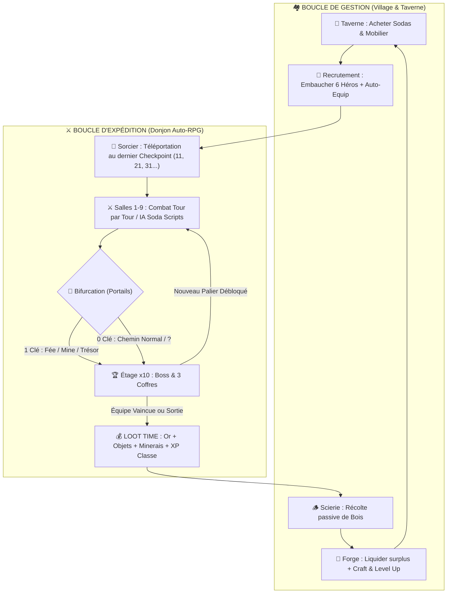
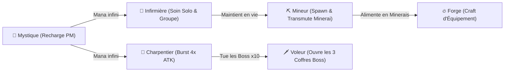

# 🍺 Dossier d'Inspiration Game Design : Soda Dungeon 2

> **Note (23/10/2026)** : dossier de référence ajouté au projet Athéna pour inspiration. Les images, le diaporama et les fiches détaillées cités ci-dessous sont restés sur le PC de Baptiste (`C:/Users/Bapti/...`) : leurs liens ne s’ouvrent pas ici. Comme pour Pixelio, on étudie les systèmes, on ne reprend ni images, ni textes, ni noms.

Ce document synthétise l'ensemble des **mécaniques de gameplay, boucles systémiques, patterns UI/UX et leviers de rétention** observés et capturés en direct dans **Soda Dungeon 2**, et indexe votre dossier local de référence créé dans [`soda_dungeon_2_inspiration`](file:///C:/Users/Bapti/.gemini/antigravity/scratch/soda_dungeon_2_inspiration/README.md).

> [!TIP]
> **Nouveau — Diaporama Explicatif & Planches Visuelles** : Vous pouvez consulter le diaporama interactif complet [`diaporama_explicatif_soda_dungeon_2.html`](file:///C:/Users/Bapti/.gemini/antigravity/brain/be32b17e-2503-410b-99a8-75b102572162/diaporama_explicatif_soda_dungeon_2.html) ou parcourir ci-dessous les **diapositives infographiques Google Image** et les **planches de références annotées (1080p)** stockées dans [`diapos_explicatives/`](file:///C:/Users/Bapti/.gemini/antigravity/scratch/soda_dungeon_2_inspiration/diapos_explicatives).

---

## 🖼️ 0. Diapositives Explicatives (Google Image Pixel-Art & Planches de Références Annotées)

### 🎨 A. Infographies Explicatives Générées (Style Pixel-Art fidèle aux Références)

````carousel

<!-- slide -->

<!-- slide -->

<!-- slide -->

````

### 📸 B. Diapositives Explicatives avec Captures de Référence Annotées (1920×1080)

````carousel

<!-- slide -->

<!-- slide -->

<!-- slide -->

<!-- slide -->

````

---

## 🔄 1. Architecture Systémique : La Double Boucle (*Dual-Loop*)

L'addictivité de *Soda Dungeon 2* repose sur l'alternance rapide entre une **boucle de gestion/investissement (Village & Taverne)** et une **boucle d'expédition semi-automatique (Donjon)** où **aucune défaite n'est punitive** (100 % du butin et de l'XP ramassés sont conservés).



---

## 🏘️ 2. Le Hub (Village) et le Déblocage Hybride des Bâtiments

Plutôt que de submerger le joueur dès le départ, le village s'ouvre progressivement via l'atelier du **Charpentier**. Chaque bâtiment propose une **double condition de déblocage** : accomplir un objectif en jeu (qui divise le prix par deux ou le rend gratuit) **ou** payer immédiatement le prix fort en Or/Caps.

````carousel

<!-- slide -->

<!-- slide -->

<!-- slide -->

````

*Fiche complète :* [`01_boucle_principale_et_economie.md`](file:///C:/Users/Bapti/.gemini/antigravity/scratch/soda_dungeon_2_inspiration/docs/01_boucle_principale_et_economie.md)

---

## 🍺 3. La Taverne, les Sodas et l'Écosystème de Classes

La Taverne remplace le traditionnel menu de création d'équipe par un **système d'attraction probabiliste** :
- **Sodas (`Sodas`)** : Chaque boisson achetée débloque une classe d'aventurier. Le joueur peut activer/désactiver chaque soda à volonté pour filtrer les classes qui apparaissent.
- **Mobilier (`Stools` & `Tables`)** : Les tabourets offrent **30 % de chance** d'apparition d'un client par siège, et les tables **50 % de chance**.
- **Anti-Softlock (`Soda Junkie` à `0G`)** : La première classe est 100 % gratuite et arrive pré-équipée d'objets de fortune. Le joueur ne peut jamais tomber en faillite bloquante.

````carousel

<!-- slide -->

<!-- slide -->

<!-- slide -->

<!-- slide -->

````

### Matrice des Rôles et Synergies de Classes



*Fiche complète :* [`02_taverne_classes_et_synergies.md`](file:///C:/Users/Bapti/.gemini/antigravity/scratch/soda_dungeon_2_inspiration/docs/02_taverne_classes_et_synergies.md)

---

## ⚔️ 4. Combat, IA Programmable (`Soda Scripts`) & Bifurcations

Le donjon combine **combat au tour par tour à 6 héros**, **programmation d'IA par le joueur (*Soda Scripts*)** et **choix de portails avec clés** :
- **Cadence de 10 étages** : Chaque 10e étage (`10, 20, 30...`) contient un Boss qui débloque le palier de téléportation suivant (`11, 21, 31...`) chez le Sorcier.
- **Événement `A fork in the road!`** : Permet d'utiliser une **Clé** pour entrer dans un portail garanti (**Fée de soin 100 % PV/PM**, **Galerie de Mine**, **Salle au trésor**) ou de tenter un portail gratuit inconnu (`?`).

````carousel

<!-- slide -->

<!-- slide -->

````

*Fiches complètes :* [`03_combat_ia_et_exploration.md`](file:///C:/Users/Bapti/.gemini/antigravity/scratch/soda_dungeon_2_inspiration/docs/03_combat_ia_et_exploration.md) et [`04_forge_equipement_et_ergonomie_ux.md`](file:///C:/Users/Bapti/.gemini/antigravity/scratch/soda_dungeon_2_inspiration/docs/04_forge_equipement_et_ergonomie_ux.md)

---

## 📜 5. Quêtes Évolutives, Compendium & Monétisation Douce

- **Quêtes Secondaires à Impact Mécanique** : Accomplir la quête secondaire d'une classe améliore définitivement ses compétences (ex. `Nail It` du Charpentier passe de `2x ATK` à `4x ATK`).
- **Bestiaire Transparent** : Le Livre indique directement quels objets et matériaux chaque monstre peut lâcher et à quels étages le trouver.
- **Monétisation Hybride** : Une résurrection gratuite par expédition (`Revive`) contre une publicité vidéo optionnelle, et une monnaie premium (`Caps`) qui peut aussi s'acquérir en jouant.

````carousel

<!-- slide -->

<!-- slide -->

<!-- slide -->

<!-- slide -->

````

*Fiche complète :* [`05_monetisation_et_retention.md`](file:///C:/Users/Bapti/.gemini/antigravity/scratch/soda_dungeon_2_inspiration/docs/05_monetisation_et_retention.md)

---

## 🗂️ 6. Index Complet du Dossier Local Créé

| Dossier / Fichier | Contenu |
| :--- | :--- |
| [`README.md`](file:///C:/Users/Bapti/.gemini/antigravity/scratch/soda_dungeon_2_inspiration/README.md) | Sommaire général, catalogue des 29 captures d'écran et synthèse des 7 piliers de Game Design |
| [`docs/01_boucle_principale_et_economie.md`](file:///C:/Users/Bapti/.gemini/antigravity/scratch/soda_dungeon_2_inspiration/docs/01_boucle_principale_et_economie.md) | Dual-Loop, rôle de chaque bâtiment du village, Faucets/Sinks d'or et anti-softlock |
| [`docs/02_taverne_classes_et_synergies.md`](file:///C:/Users/Bapti/.gemini/antigravity/scratch/soda_dungeon_2_inspiration/docs/02_taverne_classes_et_synergies.md) | Algorithme d'apparition en taverne, rôle de chaque classe, synergies à 6 héros et maîtrise XP |
| [`docs/03_combat_ia_et_exploration.md`](file:///C:/Users/Bapti/.gemini/antigravity/scratch/soda_dungeon_2_inspiration/docs/03_combat_ia_et_exploration.md) | Combat 6vX, mécanique de *Backstab*, programmation IA (*Soda Scripts*), cadence 10 étages et portails |
| [`docs/04_forge_equipement_et_ergonomie_ux.md`](file:///C:/Users/Bapti/.gemini/antigravity/scratch/soda_dungeon_2_inspiration/docs/04_forge_equipement_et_ergonomie_ux.md) | Équipements, châsses de gemmes, Forge circulaire et outils QoL (`Liquidate`, `Auto-Equip`, `Quick Battle`) |
| [`docs/05_monetisation_et_retention.md`](file:///C:/Users/Bapti/.gemini/antigravity/scratch/soda_dungeon_2_inspiration/docs/05_monetisation_et_retention.md) | Onboarding par quêtes, Bestiaire intégré, monétisation F2P éthique et boucle de Prestige (*Dimensions*) |
| [`screens/01_hub_et_batiments/`](file:///C:/Users/Bapti/.gemini/antigravity/scratch/soda_dungeon_2_inspiration/screens/01_hub_et_batiments) | 5 captures du Hub, du Charpentier, des coûts de construction et de la Boîte aux lettres |
| [`screens/02_taverne_et_recrutement/`](file:///C:/Users/Bapti/.gemini/antigravity/scratch/soda_dungeon_2_inspiration/screens/02_taverne_et_recrutement) | 10 captures de la Taverne, des Sodas, des Tabourets/Tables et des fiches de recrutement |
| [`screens/03_combat_et_donjon/`](file:///C:/Users/Bapti/.gemini/antigravity/scratch/soda_dungeon_2_inspiration/screens/03_combat_et_donjon) | 6 captures du combat au tour par tour, du mode Auto, des clés et des portails de bifurcation |
| [`screens/04_butin_quetes_et_progression/`](file:///C:/Users/Bapti/.gemini/antigravity/scratch/soda_dungeon_2_inspiration/screens/04_butin_quetes_et_progression) | 7 captures de `Loot Time!`, de l'inspection d'objets, des Quêtes et du Livre Compendium |
| [`screens/05_boutique_et_monetisation/`](file:///C:/Users/Bapti/.gemini/antigravity/scratch/soda_dungeon_2_inspiration/screens/05_boutique_et_monetisation) | 2 captures de la Boutique Premium et de la fenêtre de résurrection publicitaire |
